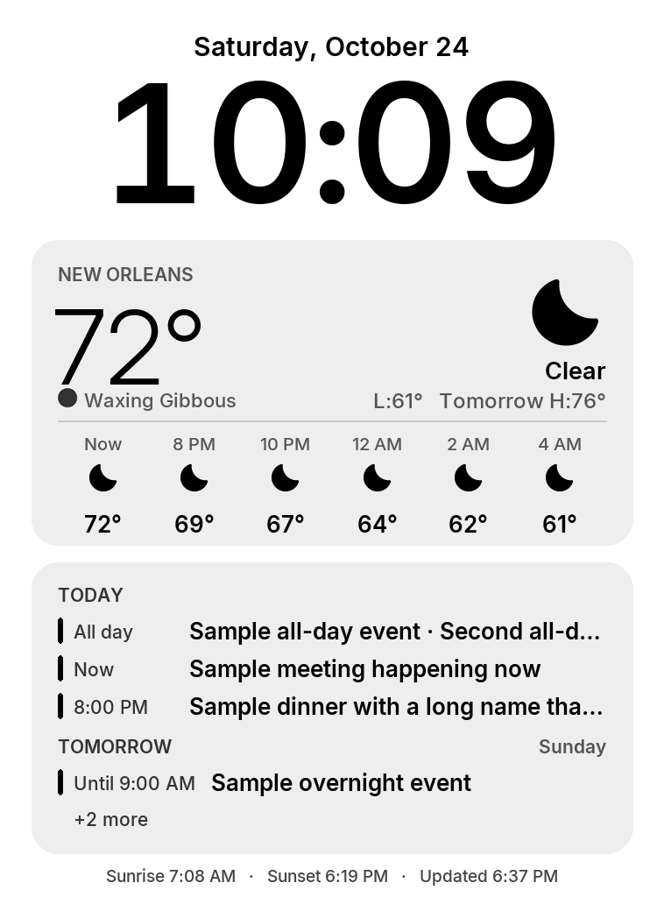

# kindle-dashboard

An Apple-style wall dashboard for a jailbroken Kindle Paperwhite (5th gen, firmware 5.6.1.1):
a big clock, local weather and moon phase from the National Weather Service and astral, and today's/tomorrow's
events from Google Calendar.

## How it works

- **`render/render.py`** draws a 758×1024, 16-level-gray image (date, weather card with moon phase, calendar card)
  as raw framebuffer rows (`dashboard.gz`) plus `meta.txt` (render time). A GitHub Action runs it every 10 minutes,
  **encrypts both files** (AES-256-CBC, key in the `DASH_KEY` secret) and publishes them to GitHub Pages.
  Pages artifacts in a public repo can be downloaded by any GitHub user, so nothing readable is ever published;
  the `DASH_TOKEN` path only keeps the URL out of sight.
- **The clock is drawn on the Kindle.** `render/make_clock.py` pre-renders all 720 times (tabular digits, so
  only changed digits move) and the status banners. The Kindle works out US Central time and DST itself.
- **`kindle/extensions/dashboard`** is a KUAL extension. *Start dashboard* stops the Kindle UI, disables the
  screensaver, and loops: clock every minute, fetch every 5 minutes, full refresh hourly. It decrypts and
  size-checks every download before using it, keeps the last good image for the next start, corrects the device
  clock from the server's `Date` header, and shows a footer banner when data is stale (45 min), the battery is low,
  or nothing has arrived yet. **Press the power button to exit** back to the normal Kindle UI.

## Secrets (Settings → Secrets and variables → Actions)

| Secret | Example |
|---|---|
| `GCAL_ICS` | Google Calendar "secret address in iCal format" (several allowed, one per line) |
| `DASH_LAT`, `DASH_LON` | `29.95`, `-90.07` |
| `DASH_PLACE` | label on the weather card |
| `NWS_GRID` | from `https://api.weather.gov/points/LAT,LON` → `gridId/gridX,gridY`, e.g. `LIX/68,88` |
| `NWS_STATION` | nearest observation station, e.g. `KMSY` |
| `DASH_TOKEN` | random path segment: files live at `https://<user>.github.io/<repo>/<DASH_TOKEN>/` |
| `DASH_KEY` | encryption passphrase (`openssl rand -hex 32`); the same value goes in the Kindle's `key.txt` |

## Installing on the Kindle

1. `python render/make_clock.py` (writes `kindle/extensions/dashboard/clock/` and `banner/`).
2. Copy `fbink` from a KOReader `koreader-kindle-*.zip` release (`koreader/fbink`) into
   `kindle/extensions/dashboard/bin/`. That build has no image support; the dashboard only uses it to refresh.
3. Put the base URL (`https://<user>.github.io/<repo>/<DASH_TOKEN>`) in `kindle/extensions/dashboard/url.txt`
   and the `DASH_KEY` value in `kindle/extensions/dashboard/key.txt`.
4. Copy `kindle/extensions/dashboard` to `/mnt/us/extensions/` and launch it from KUAL.

*Run diagnostics* in the same KUAL menu writes `diag.txt` (tools, OpenSSL round trip, power properties, network).
The Kindle's 2015 CA bundle can't verify modern certificates, so it fetches with `curl -k`; the encryption is what
protects the content.

## Operations

- GitHub runs `*/10` schedules late or skips them under load. The Kindle shows the stale banner after 45 minutes
  without a new render.
- Public repos get scheduled workflows disabled after 60 days without commits. The `keepalive` job re-enables the
  workflow on every scheduled run; if GitHub disables it anyway, re-enable it from the Actions tab.
- To rotate the key or path: set the new secret(s), run the workflow, then update `key.txt` / `url.txt` on the Kindle.
