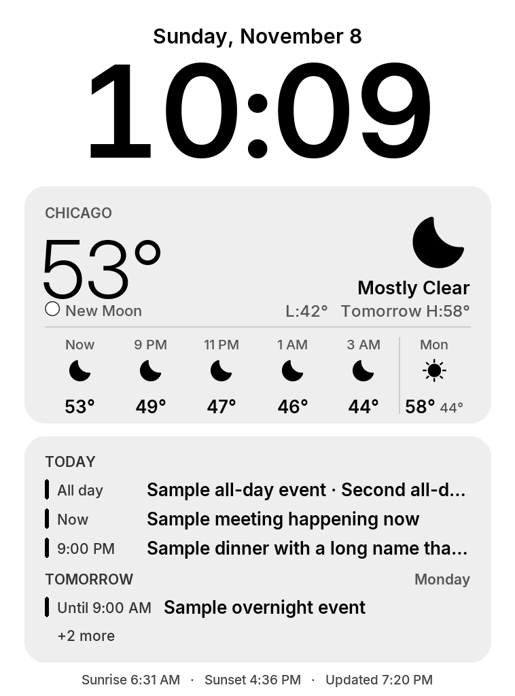

# kindle-dashboard

An Apple-style wall dashboard for jailbroken Kindle Paperwhites (running on a 5th gen at firmware 5.6.1.1 and a
6th gen at 5.6.5): a big clock, local weather and moon phase from the National Weather Service and astral, and
today's/tomorrow's events from Google Calendar.

## How it works

- **`render/render.py`** draws a 758×1024, 16-level-gray image (date, weather card with moon phase, calendar card)
  as raw framebuffer rows (`dashboard.gz`) plus `meta.txt` (render time). A GitHub Action runs it every 10 minutes,
  **encrypts both files** (AES-256-CBC, key in the `DASH_KEY` secret) and publishes them to GitHub Pages.
  Pages artifacts in a public repo can be downloaded by any GitHub user, and they show the `DASH_TOKEN` folder name,
  so the path is not a secret in practice. The encryption is what keeps the content private.
- **The clock is drawn on the Kindle.** `render/make_clock.py` pre-renders all 720 times (tabular digits, so
  only changed digits move) and the status banners. The Kindle works out US Central time and DST itself.
- **`kindle/extensions/dashboard`** is a KUAL extension. *Start dashboard* stops the Kindle UI, disables the
  screensaver, and loops: clock every minute, fetch every 5 minutes, full refresh hourly. It decrypts and
  size-checks every download before using it, keeps the last good image for the next start, corrects the device
  clock from the server's `Date` header, and shows a footer banner when data is stale (45 min), the battery is low,
  or nothing has arrived yet. **Press the power button to exit** back to the normal Kindle UI; if that ever fails,
  create a file named `stop` in the extension folder (checked once a minute). A refused start writes the reason to
  `last_error.txt` in the extension folder. Both Kindles have the same 758×1024, 768-byte-stride panel; the script
  checks the stride at startup and refuses to draw on anything else.

## Secrets (Settings → Secrets and variables → Actions)

| Secret | Example |
|---|---|
| `GCAL_ICS` | Google Calendar "secret address in iCal format" (several allowed, one per line) |
| `DASH_LAT`, `DASH_LON` | decimal degrees, e.g. `41.88`, `-87.63` |
| `DASH_PLACE` | label on the weather card |
| `NWS_GRID` | from `https://api.weather.gov/points/LAT,LON` → `gridId/gridX,gridY`, e.g. `LOT/76,73` |
| `NWS_STATION` | a station from `https://api.weather.gov/gridpoints/<grid>/stations`, e.g. `KMDW` |
| `DASH_TOKEN` | random path segment: files live at `https://<user>.github.io/<repo>/<DASH_TOKEN>/` |
| `DASH_KEY` | encryption passphrase, hex only (`openssl rand -hex 32`); the same value goes in the Kindle's `key.txt` |

The render fails (and nothing is deployed) if any of these is missing. The clock and the renderer assume US Central
time. `python render/render.py out --sample` renders a preview with a public stand-in location and sample events.

## Installing on the Kindle

1. `python render/make_clock.py` (writes `kindle/extensions/dashboard/clock/` and `banner/`).
2. Copy `fbink` from a KOReader `koreader-kindle-*.zip` release (`koreader/fbink`) into
   `kindle/extensions/dashboard/bin/`. That build has no image support; the dashboard only uses it to refresh.
   (The `fbink` that newer jailbreaks install under `/mnt/us/libkh/bin` does not run on its own; use KOReader's.)
3. Put the base URL (`https://<user>.github.io/<repo>/<DASH_TOKEN>`) in `kindle/extensions/dashboard/url.txt`
   and the `DASH_KEY` value in `kindle/extensions/dashboard/key.txt`.
4. Copy `kindle/extensions/dashboard` to `/mnt/us/extensions/` and launch it from KUAL, or copy
   `kindle/scriptlets/*.sh` to `/mnt/us/documents/` to get "Dashboard - Start" / "Dashboard - Run diagnostics"
   library entries (needs the scriptlet support from KindleModding's jb.sh / Universal Hotfix; no KUAL signing).

*Run diagnostics* in the same KUAL menu writes `diag.txt` (tools, OpenSSL round trip, power properties, network).
The Kindle's 2015 CA bundle can't verify modern certificates, so it fetches with `curl -k`; the encryption is what
protects the content.

## Operations

- GitHub runs scheduled workflows late (often by hours) or skips them, so the 10-minute cadence comes from an
  external scheduler: a cron-job.org job POSTs every 10 minutes to
  `https://api.github.com/repos/<user>/<repo>/actions/workflows/render.yml/dispatches` with body `{"ref":"main"}` and
  headers `Accept: application/vnd.github+json`, `X-GitHub-Api-Version: 2022-11-28` and
  `Authorization: Bearer <fine-grained token>` (this repo only, Actions: read and write). GitHub answers 204.
  The workflow's own hourly schedule is a fallback. The Kindle shows the stale banner after 45 minutes without a new render.
- `.github/scripts/deploy.js` (run by the deploy job) creates a marker commit on the `deploy-marker` branch
  through the Git data API (main's tree, new message), deploys the artifact under that SHA, cancels the
  deployment if it doesn't finish, and then **fetches the live `meta.bin` until it matches what was built**.
  Deploying the same SHA every run (what `actions/deploy-pages` does) left Pages serving a 12-hour-old render
  while every deploy reported success (2026-11-08); a new SHA cleared it immediately, and the verify step turns
  a repeat into a failed run. `deploy-marker` is never meant to be checked out.
- The build job (the one that runs pip packages) has a read-only token. Only the deploy job, which runs official
  actions only, can write to the repo, and a ruleset on `main` ("protect-main", bypass: repository admins) keeps
  even that token off the main branch.
- The hourly scheduled run also deletes deployment records beyond the newest 30; unreachable marker commits are
  left for GitHub's garbage collection.
- Public repos get scheduled workflows disabled after 60 days without commits. The `keepalive` job re-enables the
  workflow on every scheduled run; if GitHub disables it anyway, re-enable it from the Actions tab.
- To rotate the key or path: set the new secret(s), run the workflow, then update `key.txt` / `url.txt` on the Kindle.
  The running dashboard re-reads both on every fetch; until they match, it shows the stale banner.
